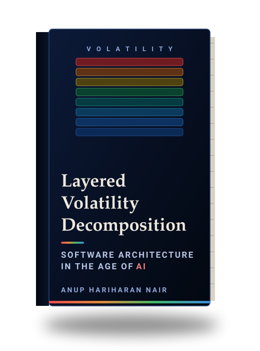
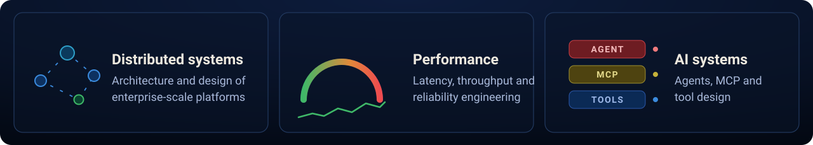

  

Software architect in New York with 20+ years of experience building enterprise-scale
platforms across financial services, healthcare, and AI-integrated applications.

## 📘 Layered Volatility Decomposition

*Software Architecture in the Age of AI*

My book extends Juval Löwy's volatility-based decomposition into eight layers,
ordered by how often each part of a system changes — from stable schemas (L1) at the
bottom to AI agents (L8) at the top. Dependencies may only point toward the stable,
so dependency cycles cannot occur by construction.

- **[Companion code](https://github.com/anuphariharan/lvd)** — every code listing
  from the book as its own file, indexed by page
- **[The book on Amazon](https://www.amazon.com/dp/B0H5G1SC1R)** — hardcover,
  paperback, and Kindle

 

## What I work on

  

## Elsewhere

- 🌐 [HiFiCoding.com](https://hificoding.com)
- ✖️ [@anuphariharan](https://x.com/anuphariharan)
